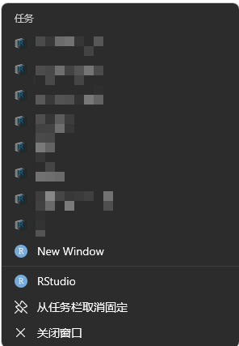

# 任务栏 Jump List 刷新工具

## 背景

Windows 任务栏按钮右键菜单里的 Jump List（「最近项目 / 工作区」）依赖系统的「显示最近使用项目」隐私设置
（`HKCU\Software\Microsoft\Windows\CurrentVersion\Explorer\Advanced\Start_TrackDocs`）。
该设置一旦关闭，列表会被系统清空。

本项目用 `ICustomDestinationList` API 实现手动给 Rstudio 和 Visual Studio Code 重建 Jump List，使其在隐私设置关闭的情况下依然可用，
并通过计划任务在锁屏/解锁时自动检查，被覆盖时自动恢复。

## 核心原理

1. **AUMID（AppUserModelID）**：Jump List 按 AUMID 归属。
   - RStudio：等于其 `rstudio.exe` 路径（优先从注册表 `App Paths\rstudio.exe` 读取，兼容非 C: 安装盘）
   - VS Code：`Microsoft.VisualStudioCode`（来自其 `product.json` 的 `win32AppUserModelId`）
2. **文件类型注册**：要让某类文件出现在应用的任务栏菜单里，该扩展名对应的 ProgID 必须注册 AUMID：
   `HKCU\Software\Classes\<ProgID>\Application\AppUserModelID`，否则报 `0x80040F03`。
3. **隐私设置的限制**：`Start_TrackDocs = 0` 时，`AppendCategory`（自定义分类）会失败
   （`E_ACCESSDENIED / 0x80070005`），但 `AddUserTasks`（任务区）仍然可用。
   因此脚本先尝试「自定义分类」，失败则自动回退到「任务模式」。
4. **VS Code 会覆盖列表**：VS Code 自身实现了 Jump List（`setJumpList` / `addRecentDocument`），
   启动时会把我们写入的列表覆盖掉，所以需要每分钟检测并重建。

## 目录结构

| 文件 | 作用 |
|---|---|
| `JumpListTool.exe` / `.cs` | 底层执行工具，由上面的脚本调用，一般无需手动运行 |
| `check_jumplist.ps1` | RStudio 刷新脚本（分类 → 失败回退任务模式） |
| `refresh_vscode_jumplist.ps1` | VS Code 刷新脚本 + 覆盖检测 |
| `app_list.example.txt` | RStudio 项目列表模板（复制为 `app_list.txt` 后填写，已 gitignore） |
| `vscode_workspaces.example.txt` | VS Code 工作区列表模板（复制为 `vscode_workspaces.txt`，已 gitignore） |
| `run_hidden.vbs` | 无窗口调用 `check_jumplist.ps1`（消除任务窗口闪烁） |
| `run_hidden_vscode.vbs` | 无窗口调用 `refresh_vscode_jumplist.ps1` |
| `launch_remote.vbs` | 读取 `.vsremote` 内的 URI 并启动 VS Code 远程窗口 |
| `launch_rstudio_new.vbs` | 供 RStudio「New Window」条目调用：设 `RS_INITIAL_PROJECT=none` 启动空白新会话 |
| `docker.ico` / `docker.svg` | 远程（Dev Container）条目的图标 |
| `JumpList-Refresh-Rstudio.xml` | RStudio 计划任务（锁屏 / 解锁 +10s） |
| `JumpList-Refresh-VSCode.xml` | VS Code 计划任务（每分钟检测） |
| `workspaces\` | 自动生成的 `.code-workspace` / `.vsremote` 条目文件（已 gitignore） |
| `workspaces.hash` | `vscode_workspaces.txt` 的内容哈希，用于检测配置变更（已 gitignore） |
| `jumplist.log` | 运行日志（已 gitignore） |

## 使用

### 第 1 步：创建配置文件

仓库不含个人配置，从模板复制两份（真实文件已在 `.gitignore` 中，不会被提交）：

```powershell
copy app_list.example.txt app_list.txt
copy vscode_workspaces.example.txt vscode_workspaces.txt
```

### 第 2 步：填入你自己的项目

编辑 `app_list.txt`，每行一个 `.Rproj` 路径：

```
D:\projects\my project\my project.Rproj
D:\projects\another project\another project.Rproj
```

编辑 `vscode_workspaces.txt`：

- **本地文件夹**：直接写文件夹路径
  ```
  D:\code\my project
  ```
- **远程工作区（Dev Container / SSH）**：写 `vscode-remote://... |显示名`。
  URI 可在 VS Code 远程窗口中打开命令面板 → `Remote: Open Workspace Configuration File` 获取
  ```
  vscode-remote://ssh-remote+myserver/home/user/projects/myproject|myproject
  ```

### 第 3 步：手动生成一次，确认可用

```powershell
powershell -ExecutionPolicy Bypass -File ".\check_jumplist.ps1"      # RStudio
powershell -ExecutionPolicy Bypass -File ".\refresh_vscode_jumplist.ps1"  # VS Code
```

右键任务栏图标，应能看到列表（见下方「效果示例」）。

### 第 4 步：导入计划任务，让它自动保持

Jump List 会被系统和应用清空，需靠计划任务定期恢复。

> 若你的账户能以管理员身份运行命令行，任务可直接用 `schtasks` 创建；
> 否则需手动导入（部分账户受 UAC 限制无法命令行创建）。

先把两个 XML 里的 `<WorkingDirectory>` 改成你自己的项目目录（默认是占位符 `C:\path\to\jump-list-refresh`），然后：

1. `Win+R` → `taskschd.msc`
2. 右侧「导入任务」，分别选择 `JumpList-Refresh-Rstudio.xml`、`JumpList-Refresh-VSCode.xml`

导入后即生效：

- **RStudio 任务**：锁屏 / 解锁后 10 秒重建列表
- **VS Code 任务**：每分钟检查一次，VS Code 覆盖了列表就自动重建

## 效果示例

以下截图中的项目名已做打码处理。

### RStudio



- 每个 `.Rproj` 成为一个条目，显示名为**项目名（去掉 `.Rproj` 后缀）**，图标取自 `.Rproj` 文件
- **New Window**：启动一个**空白新会话**（不带任何项目），由 `launch_rstudio_new.vbs`
  设置 `RS_INITIAL_PROJECT=none` 实现
- 末两项（RStudio / 从任务栏取消固定 / 关闭窗口）是系统自动附加的，不可控

### VS Code


- 本地工作区显示名为**文件夹名**，图标为 VS Code 图标
- 远程工作区（Dev Container）显示为自定义名称，图标为 **Docker 图标**（取自项目根目录的 `docker.ico`）
- **New Window**：等价于 `Code.exe --new-window`，强制开新窗口而不复用上次活动窗口

两个列表中，鼠标悬停在条目上会显示 tooltip：RStudio 显示 `.Rproj` 完整路径，
VS Code 本地项显示实际项目文件夹、远程项显示工作区 URI。